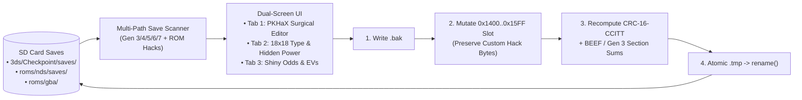

# PokeDash (`3ds_pokedash`)

<p align="center">
  
  &nbsp;&nbsp;&nbsp;
  
</p>

> **Pokemon Save Editor (`CTR-P-PKDS`, UniqueId `0x0D3E1`)** — Part of the [**lafiabrew**](https://github.com/orgs/lafiabrew/repositories) Nintendo 3DS Homebrew Suite (companion hub: [`lafiabrew/3ds_hub`](https://github.com/lafiabrew/3ds_hub)).

PKHaX-inspired permissive Pokémon Gen 3–7 & ROM-Hack surgical save inspector/editor + Dual-Screen Type Matchup, Nature, Hidden Power, Shiny Odds, and EV Companion for Nintendo 3DS.

---

## Architecture & Data Flow



---

## Controls & Touch Ergonomics (Old 3DS · 2DS · New 3DS XL)

| Button / Input | Action |
|---|---|
| `L` / `R` (or Touch Top Tabs) | Switch between **PKHaX Edit**, **Type Chart**, and **Shiny/EV** tabs |
| `SELECT` | Cycle between discovered Pokémon save files on SD card |
| `D-Pad Left / Right` | Select Party Pokémon slot (`1..6`) or adjust Type Chart defender types |
| `D-Pad Up / Down` | Scroll through the 11 surgical PKHaX presets (`Max IVs 6x31`, `Trick Room 0 Spe`, `Toggle Shiny PID`, `Cycle Nature`, `Max Friendship`, `Level 100`, `EV 252/252`, `Max Money + 999 Items`) |
| `A` (or Touch Action Row) | Apply selected surgical edit (writes `<save>.bak`, updates CRC, commits via `.tmp` -> `rename()`) |
| `X` | Rescan SD card save directories |
| `START` | Flush logs (`sdmc:/3ds/logs/pokedash.log`) and exit |

---

## SD Card Paths & Telemetry Logs

- `sdmc:/3ds/Checkpoint/saves/**` — Decrypted 3DS Gen 6 (`XY`/`ORAS`) & Gen 7 (`SM`/`USUM`) `main` saves
- `sdmc:/roms/nds/saves/*.sav` & `sdmc:/_nds/TWiLightMenu/**` — NDS Gen 4/5 & Drayano ROM-hack saves
- `sdmc:/roms/gba/*.sav` & `sdmc:/3ds/open_agb_firm/saves/**` — GBA Gen 3 & CFRU/decomp ROM-hack saves
- `sdmc:/3ds/logs/pokedash.log` — Structured UTC operational & error telemetry log

---

## Build, Verify & Install

```bash
# 1. Run host C11 ASan/UBSan pass-the-pass & fail-the-fail unit + UI tests
make test

# 2. Build optimized ARM11 (-Os -flto + stripped ELF) .elf, .smdh, .3dsx, and .cia
make 3ds && make verify-3ds

# 3. Serve FBI QR code or push .cia over LAN via serve_3ds.py
make qr
```
